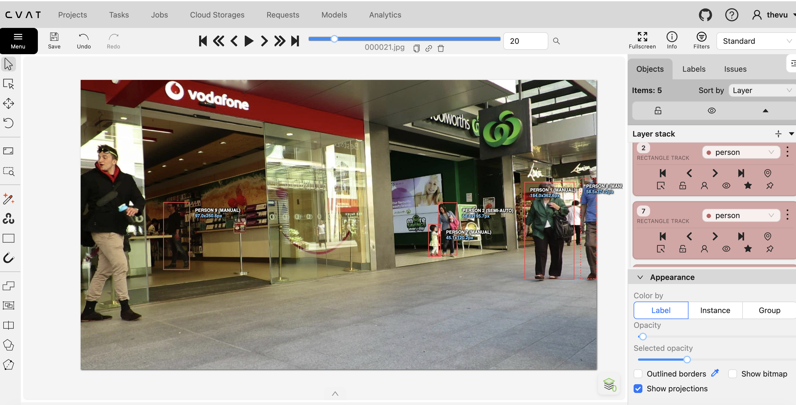
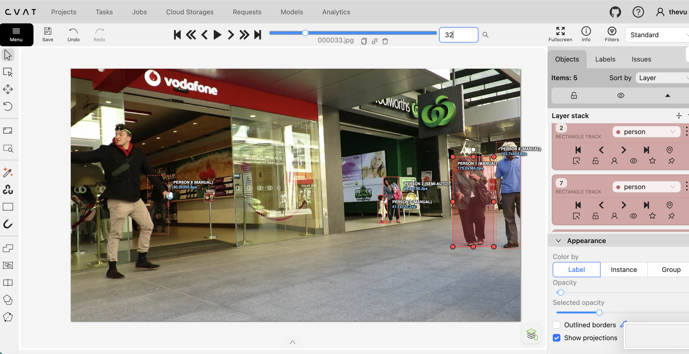
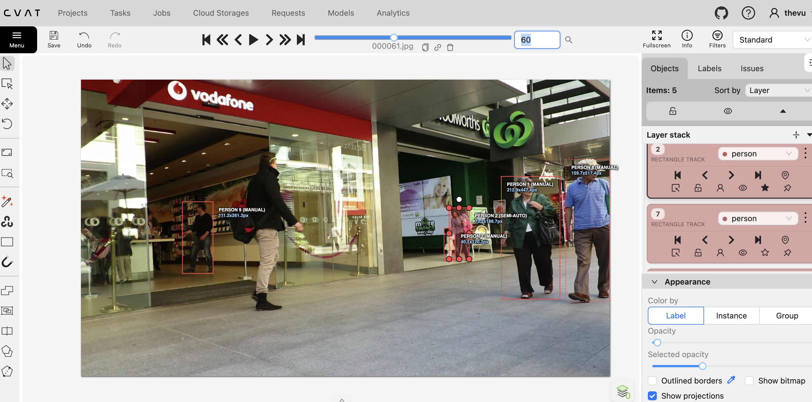
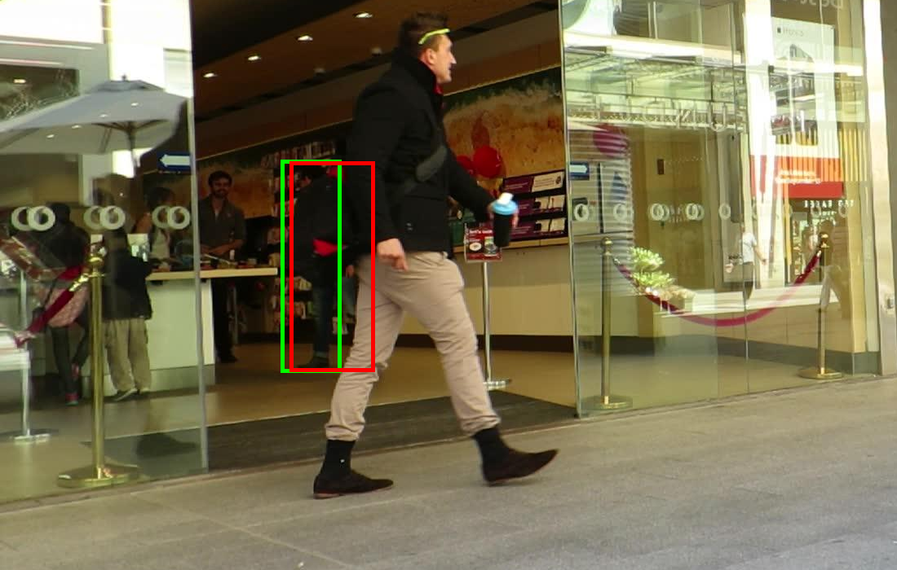

# Báo cáo cá nhân — Vũ Duy Thế - 2A202604054

Đổi tên file theo quy tắc `MSSV_HoTen.md`. Ví dụ: `20241234_NguyenVanAn.md`.

Đoạn video: MOT17-09, 150 frame (frame 1–150), nguồn MOTChallenge, giấy phép CC BY-NC-SA 3.0.

## 0. Thông tin học viên

- Họ tên: Vũ Duy Thế
- MSSV: 2A202604054
- Mã đề (A/B/C): B
- Email: ts2a1996@gmail.com
- Link repository: https://github.com/ethan4496/K5-L2B-DAY05-VuDuyThe-2A202604054-MOTTracking
- Giờ bắt đầu: 16:30
- Giờ kết thúc: 2:30

## 1. Xem trước đoạn video (CP0)

Ghi **trước khi vẽ**, mỗi người một dòng. Số frame theo CVAT (bắt đầu từ 0).

| Mã | Frame xuất hiện | Frame cuối thấy được | Rẽ / dừng / đổi tốc độ ở frame | Bị che ở frame | Ghi chú |
|---|---|---|---|---|---|
| P1 | 0 | 149 | Đi sang phải 0–30; khựng lại ~30–50; đi tiếp 50–90; đứng yên ~90–130; lùi nhẹ sang trái 130–149 | 30–59 (người mặc áo khoác đen đi ngang phía trước), mất hẳn ở 39 | Người áo tối, quần jeans, đứng trong cửa hàng sau lớp kính |
| P2 | 0 | 149 | Đi thẳng về phía camera, chếch sang trái; tăng tốc rõ từ ~110 | Không | Bà mặc áo khoác xanh lá, đeo túi; box to dần (cao 341 → 846 px) |
| P3 | 0 | 149 | Vào từ mép phải, đi cạnh P2 về phía camera; tăng tốc từ ~100 | 0–69 (bị mép phải khung hình cắt) | Ông áo xanh dương, đội mũ lưỡi trai; đi song song với P2 |
| P4 | 0 | 118 | Đi sang phải 0–~45; đứng yên từ ~50 | 106–118 (P2 đi ngang phía trước), mất hẳn từ 119 | Người nhỏ ở xa, đứng cạnh màn hình quảng cáo |
| P5 | 0 | 109 | Đi sang phải 0–~20; đứng yên từ ~20 | 100–109 (P2 đi ngang phía trước), mất hẳn từ 110 | Người nhỏ ở xa, đứng sát P4 |

## 2. Keyframe và thời gian (CP1, CP4)

Số keyframe lấy từ kết quả `src/check_submission.py`.

| Mã | Số keyframe | Keyframe ở frame | Số frame có mặt | Keyframe / 100 frame | Thời gian (phút) | Chỗ khó |
|---|---|---|---|---|---|---|
| P1 | 16 | 0, 10, 20, …, 140, 149 (mỗi 10 frame) | 149 | 10.7 | ... | Bị người đi ngang che 30–59, mất hẳn ở frame 39 |
| P2 | 16 | 0, 10, 20, …, 140, 149 (mỗi 10 frame) | 150 | 10.7 | ... | Lại gần camera, box to nhanh ở cuối đoạn |
| P3 | 16 | 0, 10, 20, …, 140, 149 (mỗi 10 frame) | 150 | 10.7 | ... | Bị cắt ở mép phải 0–69, chiều rộng box đổi liên tục |
| P4 | 7 | 0, 10, 20, 30, 40, 50, 106 | 119 | 5.9 | ... | Người nhỏ, bị P2 che 106–118 rồi khuất đến hết video |
| P5 | 19 | 0–14 (từng frame), 20, 40, 60, 100 | 110 | 17.3 | ... | Người nhỏ, bị P2 che 100–109 rồi khuất đến hết video |
| **Tổng** | **74** | | **678** | **10.9** | ... | |

Keyframe / 100 frame của cả bài = tổng keyframe ÷ tổng số frame có mặt × 100 = 74 ÷ 678 × 100 = **10.9**

Bạn đặt keyframe nhiều nhất ở người nào? Vì sao (người đó rẽ, dừng, lại gần camera hay bị che)?

Nhiều nhất là P5 (19 keyframe, 17.3 / 100 frame). Ở frame 0–14 em dùng tracking bán tự động nên CVAT tạo một keyframe ở mỗi frame, đúng đoạn P5 đang đi rồi dừng. Sau đó P5 đứng yên nên chỉ cần keyframe thưa (20, 40, 60). Em thêm keyframe ở 100 vì P2 bắt đầu đi ngang che P5. Ngược lại, P4 cũng đứng yên từ ~50 nên chỉ cần 7 keyframe.

## 3. Đoạn bị che (CP2)

Người bị che: `P1`

| Mốc | Frame |
|---|---:|
| Bắt đầu bị che một phần (bật `occluded`) | 30 |
| Mất hẳn (bật `outside`) | 39 |
| Hiện lại (tắt `outside`) | 40 |
| Thấy rõ trở lại (tắt `occluded`) | 60 |

- Thời gian khuất hẳn: 1 frame = ~0.03 giây (MOT17-09 có 30 fps).
- Quyết định: **giữ cùng ID**.
- Lý do (trả lời 3 câu: khuất bao lâu so với 60 frame, ngoại hình có khớp, chỗ hiện lại có đúng hướng và tốc độ):

  1. P1 chỉ khuất hẳn 1 frame, ít hơn rất nhiều so với ngưỡng 60 frame (2 giây).
  2. Người hiện lại có cùng áo tối, quần jeans, cùng chiều cao box (~251 px).
  3. P1 hiện lại đúng vị trí (tâm x ≈ 374 px ở frame 38 và 40), vẫn đi sang phải chậm như trước khi bị che.

Ảnh chụp màn hình:





## 4. Tự review ID (CP3)

Lượt 1 theo người (đi ngược từ frame 149 về 0 trên CVAT), lượt 2 theo cảnh (nhảy 10 frame). Ít nhất 3 dòng; không có lỗi thì ghi một dòng "đã kiểm hai lượt, không lỗi".

Loại lỗi dùng đúng một trong 7 mã: `id_switch`, `fragmentation`, `lost`, `merge`, `false_track`, `drift`, `flag`.

| Frame | Mã người | Loại lỗi | Mô tả một câu | Phát hiện ở lượt | Đã sửa? |
|---:|---|---|---|---|---|
| 0–69 | P3 | `flag` | Cờ `occluded` bật cho cả đoạn P3 bị mép phải khung hình cắt, nhưng thực ra P3 không bị ai che. | 1 | Chưa |
| 50–106 | P4 | `drift` | Chỉ có 2 keyframe (50 và 106) cho 56 frame; em đã kiểm lại: P4 đứng yên nên box không trôi. | 1 | Không cần sửa |
| 100–119 | P4, P5 | `lost` | Kiểm tra xem P4/P5 có lộ ra sau lưng P2 trong 110–149 không; không thấy, nên `outside` đến hết video là đúng. | 2 | Không cần sửa |

Tổng hợp số lỗi theo loại:

| `id_switch` | `fragmentation` | `lost` | `merge` | `false_track` | `drift` | `flag` |
|---:|---:|---:|---:|---:|---:|---:|
| 0 | 0 | 0 | 0 | 0 | 0 | 1 |

Lỗi nào chỉ lượt 2 (theo cảnh) mới thấy, lượt 1 (theo người) không thấy? Vì sao?

Chỗ P2 đi ngang che P4 và P5 (100–119). Khi xem theo từng người, em chỉ thấy P4/P5 biến mất. Xem theo cảnh, nhảy 10 frame, mới thấy rõ chính P2 che họ và cần kiểm tra họ có lộ ra lại sau lưng P2 không. Lượt 1 không cho thấy quan hệ giữa các người trong cùng một frame.

## 5. File xuất và kết quả tự kiểm (CP4)

| Kiểm tra | Kết quả |
|---|---|
| Tên file MOT 1.1 | `src/exports/VuDuyThe_mot.zip` (chỉ gồm `gt/gt.txt`, `gt/labels.txt`, không kèm ảnh) |
| Tên file CVAT for video 1.1 | `src/exports/VuDuyThe_cvat_video.zip` (chỉ gồm `annotations.xml`) |
| Số track ID khác nhau trong `gt/gt.txt` (phải là 5) | 5 |
| Frame `outside` không có dòng trong `gt.txt` (đúng / sai) | Đúng: track P1 không có dòng ở frame CVAT 39 (`frame_id` 40); P5 không có dòng từ 110, P4 không có dòng từ 119 |
| Job đã completed trên CVAT máy cá nhân | ... |

Dán phần tóm tắt in ra từ `src/check_submission.py`:

```text
=== File MOT 1.1: VuDuyThe_mot.zip ===
  Số track ID: 5   |   Tổng số box: 678
  [OK]        Đúng 5 track ID.

  Track | Frame có mặt | Số frame | Đoạn vắng (outside)
      1 |   0–149      |      150 | -
      2 |   0–109      |      110 | -
      3 |   0–118      |      119 | -
      4 |   0–149      |      150 | -
      5 |   0–149      |      149 | 39

=== File CVAT for video 1.1: VuDuyThe_cvat_video.zip ===
  Track | Nhãn   | Frame thấy | Keyframe | KF/100 frame | Frame occluded | Lần bật outside
      0 | person |        150 |       16 |         10.7 |              0 |               0
      1 | person |        110 |       19 |         17.3 |             10 |               1
      2 | person |        119 |        7 |          5.9 |             13 |               1
      3 | person |        150 |       16 |         10.7 |             70 |               0
      4 | person |        149 |       16 |         10.7 |             29 |               1

  Tổng: 74 keyframe / 678 frame có mặt = 10.9 keyframe / 100 frame
  [OK]        Đọc được 5 track từ annotations.xml.

=== Tóm tắt ===
  Lỗi: 0   |   Cảnh báo: 0
  Đạt. Dán phần tóm tắt này vào báo cáo mục 5.
```

Đối chiếu track ID với mã người: MOT 1 / CVAT 0 = P2, MOT 2 / CVAT 1 = P5, MOT 3 / CVAT 2 = P4, MOT 4 / CVAT 3 = P3, MOT 5 / CVAT 4 = P1.

## 6. Ba câu kết

1. Nếu được gán lại, bạn sẽ đặt keyframe khác ở đâu? Vì sao?

   Em sẽ không đặt keyframe đều mỗi 10 frame cho P1, P2, P3 nữa mà đặt ở chỗ chuyển động thay đổi. Với P1 là 30, 50, 90, 130 (dừng, đi, đứng, lùi). Với P2, P3 là đoạn 100–149, khi họ lại gần camera và box to nhanh. Ở P5 em sẽ bỏ các keyframe dày từng frame 0–14 do tracking bán tự động tạo ra, chỉ giữ 0, ~20 (lúc dừng) và 100. Ở P4 em sẽ thêm một keyframe khoảng 100 ngay trước khi P2 che.

2. Có chỗ nào bạn không chắc "cùng ID hay ID mới"? Bạn đã quyết định và ghi chú thế nào?

   Chỗ em phân vân là P1 ở frame 39, khi người mặc áo khoác đen nhảy ngang che hết P1. P1 chỉ khuất 1 frame, hiện lại cùng chỗ, cùng quần áo, nên em giữ cùng ID: bật `outside` ở 39 và `occluded` cho 30–59. Với P4 và P5, sau khi bị P2 che (từ 119 và 110) họ không hiện lại trước frame 149. Vì vậy em bật `outside` đến hết video, không tạo track mới.

3. Một lỗi ID trong job của bạn (nếu không còn sót, chọn lỗi đã sửa) có thể làm xe tự lái dự đoán sai chuyển động của người đó như thế nào? Lỗi đó ảnh hưởng MOTA hay IDF1 nhiều hơn?

   Nếu ở frame 40 em tạo ID mới cho P1 (`fragmentation`), hệ thống sẽ mất lịch sử chuyển động của P1. Nó sẽ coi đây là một người mới xuất hiện, chưa biết vận tốc và hướng đi, nên không dự đoán được P1 đang đi chậm sang phải và có thể phản ứng muộn. Tương tự, nếu ở frame 100–110 box của P5 nhảy sang P2 (`id_switch`), xe sẽ tưởng một người đang đứng yên đột nhiên lao nhanh về phía camera. Lỗi này ảnh hưởng **IDF1** nhiều hơn: MOTA chỉ phạt 1 lần ID switch, còn IDF1 tính sai danh tính cho mọi frame sau đó.

## Bonus (nếu làm)

### B1 — Hai người đi sát

Không làm. File `*_mot.zip` chỉ có 5 track của đề B.

### B2 — So cách đặt keyframe

Người chọn: **P1**. P1 đổi chuyển động nhiều lần: đi sang phải, khựng lại khi bị che (30–50), đi tiếp, đứng yên (~90–130) rồi lùi nhẹ.

Track phụ lấy box của track chính ở các frame keyframe, rồi nội suy tuyến tính giữa các keyframe như CVAT, không chỉnh thêm. Độ trôi đo bằng khoảng cách tâm box và IoU so với track chính (16 keyframe, đã kiểm tay).

| Cách đặt | Số keyframe | Frame trôi nhất | Ghi chú |
|---|---:|---:|---|
| Đều mỗi 30 frame | 6 (0, 30, 60, 90, 120, 149) | 50 | Tâm lệch 26 px, IoU 0.54 (box cao ~261 px); IoU trung bình 0.88 |
| Theo chỗ đổi hướng | 8 (0, 30, 38, 40, 50, 90, 130, 149) | 70 | Tâm lệch 20 px, IoU 0.66; IoU trung bình 0.90 |



Giải thích bằng giả định vận tốc không đổi: giữa hai keyframe, CVAT nội suy tuyến tính, tức là coi P1 đi đều với một vận tốc không đổi. Trên track chính, tâm x của P1 là 373 px ở frame 30, 381 px ở frame 50 và 424 px ở frame 60. P1 gần như đứng yên trong 30–50 (bị người áo đen đi ngang che), rồi đi nhanh lại trong 50–60.

Với keyframe đều 30 → 60, box bị "rải đều" quãng 51 px cho 30 frame. Ở frame 50 nó đã ở tâm x ≈ 407 px, vượt trước người thật 26 px (gần nửa chiều rộng box). Khi đặt keyframe ở chỗ đổi chuyển động (30, 50, 90, 130) và quanh frame bị khuất (38, 40), mỗi đoạn gần đúng vận tốc không đổi hơn, nên chỉ thêm 2 keyframe mà độ trôi lớn nhất giảm (IoU 0.54 → 0.66). Chỗ còn trôi (frame 70) nằm trong đoạn 50–90, nơi P1 đi không đều. Cần thêm một keyframe ở ~70 để sửa.

### B3 — So với tracker có sẵn

Không làm (không có video kết quả ByteTrack / BoT-SORT của coach).

## 7. Tài liệu tham khảo và công cụ AI đã dùng

...
